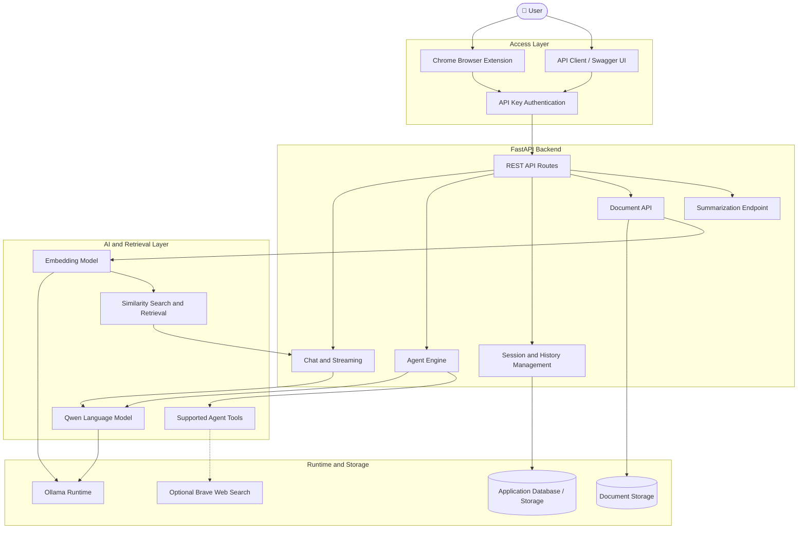
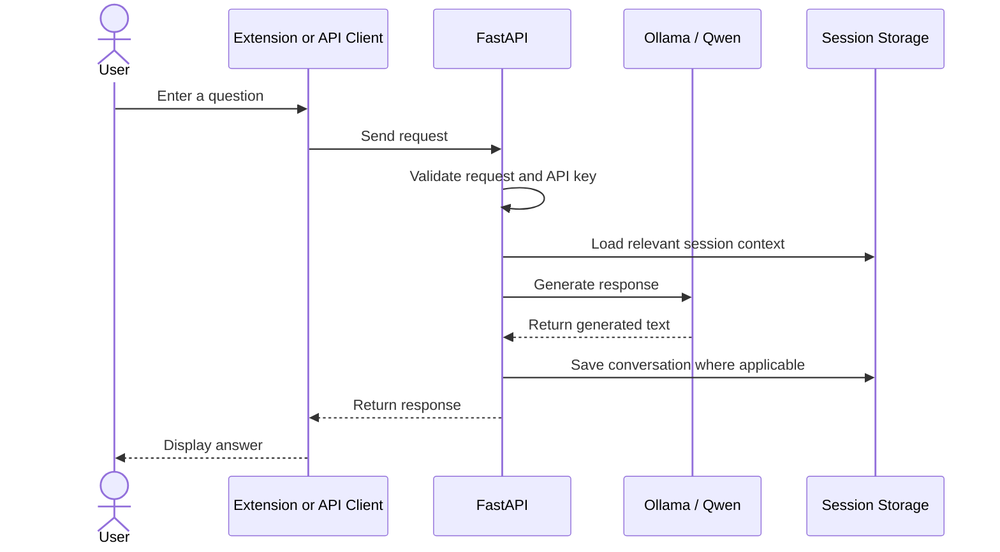
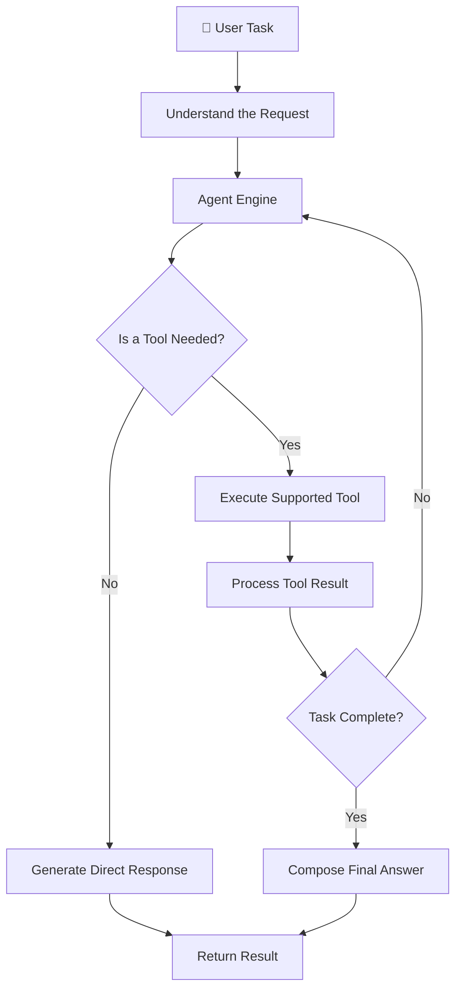
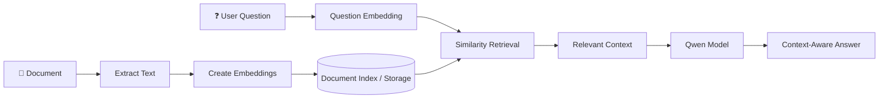
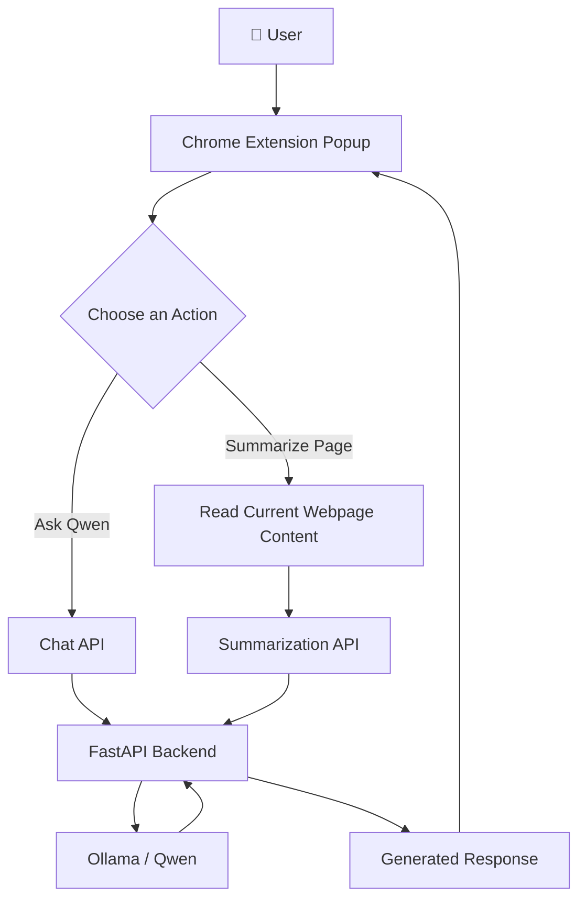

# 🧠 Qwen-Based Agentic AI System for Intelligent Web Assistance

<p align="center">
  
  
  
  
  
  
</p>

<p align="center">
  <strong>From-Scratch Design and Implementation of a Local AI Agent</strong>
</p>

<p align="center">
  A locally powered intelligent assistant that combines large language models, tool-based agent execution, document retrieval, conversational memory, API-based access, and a Chrome browser extension in one modular system.
</p>

<p align="center">
  <a href="https://github.com/rajharshit25/qwen-agent-project">📦 Source Code</a> ·
  <a href="#-system-architecture">🏗️ Architecture</a> ·
  <a href="#-live-demonstration-guide">🎬 Demonstration</a> ·
  <a href="#-installation-and-setup">⚙️ Setup</a> ·
  <a href="#-evaluation-and-testing">📊 Evaluation</a>
</p>

---

## 🎓 Academic Project Information

| Field | Details |
|---|---|
| Project Title | Qwen-Based Agentic AI System for Intelligent Web Assistance |
| Project Type | AI / Machine Learning / Agentic Systems |
| Institution | PCU School of Engineering & Technology |
| Academic Year | 2026–2027 |
| Primary Language | Python |
| Main LLM Runtime | Ollama |
| Backend Framework | FastAPI |
| Browser Interface | Chrome Extension |
| Deployment | Local execution and Docker |
| Project Repository | [rajharshit25/qwen-agent-project](https://github.com/rajharshit25/qwen-agent-project) |

---

## 🌟 1. Project Overview

Traditional chatbots generally respond to a user's message using a single language-model interaction. An agentic AI system can go further by combining language understanding with tools, task execution, contextual information, and external capabilities.

This project implements a modular AI assistant using the Qwen family of language models. It provides a local inference workflow, a Python backend, tool-based agent functionality, document retrieval, session-based conversation history, and HTTP API endpoints.

The project also includes a Chrome browser extension that provides a convenient popup interface for asking questions and summarizing the content of the current webpage through the FastAPI backend.

The extension uses a Cyber Premium visual design with selectable themes, interactive response cards, loading and status indicators, and a live date-and-time display.

The system is designed to explore how an AI assistant can move from simply generating text toward completing structured tasks and using relevant information to answer questions.

### ✨ Key Capabilities

- 🧠 **Local language-model inference:** Run supported Qwen models through Ollama.
- 🛠️ **Agentic task execution:** Use the agent engine to coordinate supported tools and task steps.
- 🌐 **Optional web search:** Integrate the configured Brave Search capability when available.
- 📚 **Document question answering:** Ingest documents, generate embeddings, retrieve relevant content, and use it to support responses.
- 💬 **Conversation history:** Maintain and retrieve conversations by session ID.
- ⚡ **Streaming responses:** Deliver chat output progressively through a streaming API.
- 🔐 **API-key authentication:** Protect non-public API routes with an `X-API-Key` header.
- 🧩 **Chrome browser extension:** Ask questions and summarize webpage content through the browser popup.
- 🎨 **Cyber Premium interface:** Dark styling with neon-inspired accents, animations, and selectable themes.
- 🌈 **Theme selection:** Switch between Cyber Neon, Midnight Purple, Emerald Matrix, and Light Mode.
- 🕒 **Live date-and-time display:** Display the current date and time in the extension popup.
- 🐳 **Containerized backend:** Build and run the API using Docker.
- 🧪 **Automated testing:** Validate API behavior, agent functionality, document routes, and streaming.

---

## 🎯 2. Problem Statement

Many basic AI assistants depend on a remote service, operate with limited context, or cannot interact with tools and local documents in a structured way.

The project addresses these challenges by developing a modular system that combines:

1. A locally hosted language model.
2. An agent engine for supported tasks and tools.
3. A document-retrieval pipeline.
4. Session-aware conversation management.
5. A secured API layer.
6. Container-based backend deployment.
7. A browser extension for direct interaction with the assistant.

The objective is to demonstrate the design, integration, and evaluation of a practical agentic AI application.

---

## 🎯 3. Project Objectives

- Design a modular architecture for an intelligent AI assistant.
- Integrate Qwen models using Ollama.
- Build REST endpoints using FastAPI.
- Implement structured agent and tool workflows.
- Develop semantic document retrieval using embeddings.
- Support conversational context and streaming responses.
- Add API authentication and containerized deployment.
- Develop a Chrome extension for asking questions and summarizing webpages.
- Provide a responsive popup interface with selectable themes and clear response states.
- Test the system's functional correctness and API performance.
- Document the system for academic presentation and future development.

---

## 🏗️ 4. System Architecture

The following diagram illustrates the major components and their relationships.



**Architecture note:** This is a logical overview, not a claim that every request passes through every component. Exact execution depends on the endpoint, task, configured tools, and available models. The browser extension acts as a client, while the FastAPI backend provides the API functionality.

### 🔹 Component Responsibilities

| Component | Responsibility |
|---|---|
| Chrome Extension | Provides the popup interface for questions and webpage summarization |
| FastAPI | Exposes HTTP endpoints and validates requests |
| Authentication | Checks API-key access for protected routes |
| Agent Engine | Coordinates supported tools and task execution |
| Qwen + Ollama | Performs local language-model inference |
| Embedding Model | Converts text into numerical vectors |
| Retrieval Engine | Finds relevant document content |
| History Manager | Stores and retrieves session conversations |
| Docker | Packages the backend and its Python dependencies |

---

## 🔄 5. How the System Works

### A. Standard Chat Workflow



1. The user submits a question through a supported client or API request.
2. The backend validates the request and checks authentication for protected endpoints.
3. The application prepares the prompt and relevant context.
4. Ollama runs the configured Qwen model and returns generated output.
5. The backend processes the response and updates conversation history where applicable.
6. The response is returned to the client.

### B. Agentic Workflow

An agentic request can involve more than a direct language-model response.



The agent engine coordinates the task and its supported tools. Tool availability and task completion depend on the application's configuration and the request.

### C. Document Question-Answering Workflow

This functionality follows the principles of retrieval-augmented generation (RAG).



The document workflow stores document content and uses embeddings to find relevant information for a query. A lexical retrieval fallback is available when embedding-based retrieval cannot be used.

### D. Chrome Extension Workflow



1. The user opens the extension popup in Chrome.
2. The user enters a question or chooses to summarize the current webpage.
3. The extension sends the relevant request to the configured backend.
4. The backend processes the request using the appropriate functionality and configured model.
5. The extension displays the response.

The exact request flow depends on the selected action and the current implementation.

---

## 🧰 6. Technology Stack

| Technology | Role |
|---|---|
| 🐍 Python | Main application language |
| 🤖 Qwen 2.5 / Qwen 3 | Language-model inference |
| 🦙 Ollama | Local model runtime |
| ⚡ FastAPI | Backend and API framework |
| 📦 Pydantic | Request and data validation |
| 🔗 HTTPX | HTTP communication |
| 🧮 Embeddings + cosine similarity | Document retrieval |
| 🐳 Docker | Backend containerization |
| 🧪 Pytest | Automated testing |
| 🌐 Cloudflare Tunnel | Temporary public access for demonstrations, when enabled |
| 🧩 JavaScript, HTML, CSS | Chrome extension interface |

### Models Used During Development

- `qwen2.5:1.5b` — lightweight language model.
- `qwen3:4b` — alternative Qwen model for supported tasks.
- `nomic-embed-text` — embedding model for document retrieval.

Models must be available in Ollama before the relevant functionality can run. Exact performance depends on the model selected, hardware, prompt, and workload.

---

## ⚙️ 7. Installation and Setup

### Prerequisites

Install the following:

- Python and pip.
- Git.
- Ollama.
- Google Chrome, for the browser extension.
- Docker Desktop, if you want to run the containerized backend.

### Step 1 — Clone the Repository

```powershell
git clone https://github.com/rajharshit25/qwen-agent-project.git

cd qwen-agent-project
```

### Step 2 — Create a Virtual Environment

```powershell
python -m venv .venv

.\.venv\Scripts\Activate.ps1
```

If PowerShell blocks activation, you can use the environment's Python executable directly instead.

### Step 3 — Install Dependencies

```powershell
python -m pip install -r requirements.txt
```

### Step 4 — Download the Required Ollama Models

Open a terminal with Ollama installed and run:

```powershell
ollama pull qwen2.5:1.5b

ollama pull nomic-embed-text
```

To download the alternative Qwen model used during development:

```powershell
ollama pull qwen3:4b
```

Check installed models:

```powershell
ollama list
```

Ensure the Ollama service is running before starting the backend.

### Step 5 — Configure Environment Variables

The application supports configuration through environment variables. The API key is particularly important.

Generate a key and save it to a local `.env` file without printing its value:

```powershell
python -c "from pathlib import Path; import secrets; p=Path('.env'); lines=p.read_text(encoding='utf-8').splitlines() if p.exists() else []; lines=[x for x in lines if not x.startswith('QWEN_AGENT_API_KEY=')]; lines.append('QWEN_AGENT_API_KEY='+secrets.token_urlsafe(32)); p.write_text('\n'.join(lines)+'\n', encoding='utf-8'); print('API key saved to .env')"
```

Load the API key into the current PowerShell session:

```powershell
$env:QWEN_AGENT_API_KEY = (Get-Content .env | Where-Object { $_ -match '^QWEN_AGENT_API_KEY=' } | Select-Object -Last 1) -replace '^QWEN_AGENT_API_KEY=', ''
```

Keep `.env` private. Never commit it to Git or publish the key in screenshots.

### Step 6 — Start the Backend

From the repository root:

```powershell
.\.venv\Scripts\python.exe -m uvicorn backend.main:app --host 127.0.0.1 --port 8000
```

Open the API documentation in your browser:

- API documentation: [http://127.0.0.1:8000/docs](http://127.0.0.1:8000/docs)
- Health check: [http://127.0.0.1:8000/health](http://127.0.0.1:8000/health)
- API health: [http://127.0.0.1:8000/api/health](http://127.0.0.1:8000/api/health)

The health endpoints are public. Other protected endpoints require a valid API key.

### Step 7 — Load the Chrome Extension

The project includes a Chrome browser extension that connects its popup interface to the local Qwen Agent backend.

1. Start the FastAPI backend and ensure it is accessible at `http://127.0.0.1:8000`.
2. Open Google Chrome.
3. Navigate to `chrome://extensions`.
4. Enable **Developer mode**.
5. Click **Load unpacked**.
6. Select the project's `extension` directory.
7. Open the Qwen Web Assistant extension from Chrome's Extensions menu.
8. Configure the API key in the extension if required by the current implementation.
9. Test **Ask Qwen** with a simple question.
10. Open an article webpage and test **Summarize Page**.

The popup includes a Cyber Premium visual design, selectable themes, loading and response states, a live date-and-time display, and the `TECHNICAL SEMINAR PROJECT` label.

**Important:** Keep the backend running while using the extension. The API address configured in the extension must match the address at which the backend is running.

**Troubleshooting tips:**

- If the extension cannot connect, check that the backend is running.
- If an API request is rejected, verify that the extension is configured with the correct API key.
- If the extension does not appear, return to `chrome://extensions` and check for errors.
- If webpage summarization fails, confirm that the current page contains readable content and that the extension has the required access.
- Do not publish API keys or other secrets.

---

## 🐳 8. Run with Docker

The repository includes a `Dockerfile` for building the backend image.

### Build the Image

From the project root:

```powershell
docker build -t qwen-agent-project:latest .
```

### Run the Container

The backend container needs access to the Ollama service on the host. On Docker Desktop for Windows, `host.docker.internal` can be used to reach host services.

```powershell
docker run -d --name qwen-agent-api -p 8001:8000 --env-file .env -e OLLAMA_BASE_URL=http://host.docker.internal:11434 -v "${PWD}\data:/app/data" qwen-agent-project:latest
```

Check the container:

```powershell
docker ps

docker logs qwen-agent-api
```

Open the Docker-hosted API:

- API documentation: [http://127.0.0.1:8001/docs](http://127.0.0.1:8001/docs)
- Health check: [http://127.0.0.1:8001/health](http://127.0.0.1:8001/health)

**Security:** Do not expose the API publicly without authentication and appropriate deployment controls. The example is intended for local development and demonstration.

### Stop the Container

```powershell
docker stop qwen-agent-api
```

To remove the stopped container:

```powershell
docker rm qwen-agent-api
```

Removing a container does not remove the project source code. Preserve any required database and document data before changing storage configuration.

---

## 🔌 9. API Reference

The FastAPI backend exposes the following implemented routes.

| Endpoint | Method | Purpose |
|---|---|---|
| `/health` | GET | Basic health check |
| `/api/health` | GET | API health status |
| `/docs` | GET | Interactive Swagger documentation |
| `/api/chat` | POST | Standard chat request |
| `/api/chat/stream` | POST | Stream chat responses |
| `/api/agent` | POST | Agent-based request |
| `/api/summarize` | POST | Summarization request |
| `/api/documents` | POST | Document ingestion |
| `/api/documents/query` | POST | Query document content |
| `/api/history/{session_id}` | GET | Retrieve session history |
| `/api/history/{session_id}` | DELETE | Delete session history |

For exact request and response schemas, consult the live Swagger documentation at `/docs`. The API may evolve as the project develops.

### Example: Health Check

```powershell
Invoke-RestMethod http://127.0.0.1:8000/health
```

### Example: Authenticated API Request

The following example demonstrates the authentication header. Replace the example route and JSON body with the schema shown in `/docs`.

```powershell
$headers = @{
    "X-API-Key" = $env:QWEN_AGENT_API_KEY
}

Invoke-RestMethod `
    -Uri "http://127.0.0.1:8000/api/chat" `
    -Method Post `
    -Headers $headers `
    -ContentType "application/json" `
    -Body '{"message":"Explain agentic AI in simple terms."}'
```

If the endpoint uses a different request schema in the current version, follow the schema displayed in Swagger.

---

## 🎬 10. Live Demonstration Guide

This section can serve as the practical demonstration sequence during a technical seminar.

### Demonstration 1 — Local AI Chat

**Objective:** Show that the application can communicate with a locally running Qwen model.

1. Start Ollama and verify that the required model is available.
2. Start the FastAPI backend.
3. Open the API documentation.
4. Submit a simple question through the chat endpoint.
5. Show the generated response.

**Suggested prompt:**

> Explain the difference between a traditional chatbot and an agentic AI system.

**What to explain:** The API receives a request, the backend prepares the model input, Ollama performs inference, and the backend returns the response.

### Demonstration 2 — Agentic Task Execution

**Objective:** Demonstrate the agent engine and supported tools.

1. Open the agent endpoint in Swagger.
2. Submit a task supported by the current agent implementation.
3. Show the returned result.
4. Explain how tool execution differs from a direct chat response.

**Important:** Use a task verified against the actual tool configuration. Do not claim that every request automatically uses tools.

### Demonstration 3 — Document-Based Question Answering

**Objective:** Demonstrate retrieval from user-provided content.

1. Upload or ingest a supported document.
2. Query the document through the document-query endpoint.
3. Compare the response with the information in the document.
4. Explain embedding generation, similarity search, and retrieval.

### Demonstration 4 — Streaming Response

**Objective:** Show progressive delivery of generated text.

1. Open the streaming endpoint.
2. Submit a suitable chat request.
3. Observe the response as it arrives.
4. Explain why streaming can improve perceived responsiveness.

### Demonstration 5 — API Security

**Objective:** Show that protected endpoints require authentication.

1. Send a request without the required API key.
2. Observe the authentication error.
3. Send the request with a valid `X-API-Key` header.
4. Explain why credentials should not be exposed in public repositories or logs.

### Demonstration 6 — Docker Deployment

**Objective:** Demonstrate containerized backend execution.

1. Build the Docker image.
2. Start the container.
3. Show the health endpoint.
4. Submit an authenticated request.
5. Explain the separation between the backend container and the host's Ollama runtime.

### Demonstration 7 — Chrome Web Assistant

**Objective:** Demonstrate the Chrome extension interface and its integration with the Qwen Agent backend.

1. Start Ollama and ensure the required model is available.
2. Start the FastAPI backend.
3. Open a webpage containing informational content.
4. Open the Qwen Web Assistant Chrome extension.
5. Enter a question and click **Ask Qwen**.
6. Show the generated answer in the extension popup.
7. Click **Summarize Page** and display the summary.
8. Demonstrate the theme selector.
9. Point out the loading and response states, live date-and-time display, and project label.

**What to explain:** The Chrome extension provides the user interface, while the FastAPI backend handles requests and communicates with the configured language model. The summarization workflow uses webpage content supplied by the extension.

**Demonstration note:** Show only features that have been tested successfully in the current implementation.

### Optional Demonstration 8 — Temporary Public Access

A Cloudflare Tunnel can provide a temporary public URL for testing the local API.

Use this only when needed. The tunnel depends on the local service and tunnel process remaining active. A temporary tunnel URL should not be treated as a permanent production deployment.

---

## 📊 11. Evaluation and Testing

Testing is important for checking the correctness of API routes, authentication, streaming, document functionality, and agent behavior.

### Automated Testing

The latest full test run during development reported:

| Metric | Result |
|---|---:|
| Tests passed | 88 |
| Tests failed | 0 |
| Warnings | 1 |
| Overall test status | Passed |

The warning was related to a deprecation in the Starlette test-client integration. It did not cause the test run to fail.

Run the test suite using:

```powershell
.\.venv\Scripts\python.exe -m pytest backend\tests -q
```

### API Performance Evaluation

A previous local Docker API evaluation produced the following results:

| Metric | Recorded Result |
|---|---:|
| Requests evaluated | 10 |
| Successful requests | 10 |
| Success rate | 100% |
| Mean latency | 0.291 seconds |
| Minimum latency | 0.197 seconds |
| Maximum latency | 0.442 seconds |

These figures represent a specific development-time test run, not a general performance guarantee. Results may vary with hardware, model selection, network conditions, endpoint behavior, and request complexity.

### Evaluation Dimensions

For a technical seminar, discuss these dimensions separately:

- **Functional correctness:** Do supported API routes return the expected results?
- **Authentication:** Are protected routes rejected when credentials are missing or invalid?
- **Reliability:** Does the application handle invalid requests and unavailable services appropriately?
- **Latency:** How long do tested requests take?
- **Retrieval relevance:** Does document retrieval return content relevant to the question?
- **Agent behavior:** Does the engine complete the supported task using the configured tools?
- **Extension integration:** Can the extension send requests to the backend and display the returned responses?
- **Deployment:** Can the API be started and tested through Docker?

Only report measurements that have actually been observed during testing.

---

## 🔐 12. Security and Privacy

Security is a key consideration when building a locally hosted AI assistant.

- 🔑 Protected routes require an API key.
- 🧪 Test credentials are used for automated tests only.
- 🚫 `.env` and secret files must not be committed to Git.
- 🛡️ The API uses an `X-API-Key` header for protected requests.
- 🖥️ Local inference reduces reliance on a remote LLM API for supported model operations.
- 🌐 Optional external tools, such as web search, may still communicate with external services.
- 🔒 A public tunnel should be used cautiously and only when needed.
- 📦 Docker packages the backend, but containerization alone does not make an application secure.
- 🧩 The extension must be configured with the appropriate backend address and credentials.
- 🔐 API keys should not be included in public screenshots, documentation, source files, or commits.

Do not publish API keys, private documents, personal data, or unredacted authentication headers in seminar screenshots.

---

## 📁 13. Repository Structure

The following is a high-level view of the important project components. Refer to the repository for the complete current directory structure.

```text
qwen-agent-project/
│
├── backend/
│   ├── agent/
│   │   └── engine.py
│   ├── api/
│   │   └── routes.py
│   ├── tools/
│   │   └── registry.py
│   ├── tests/
│   ├── config.py
│   └── main.py
│
├── extension/
│   ├── manifest.json
│   ├── content/
│   │   └── content.js
│   └── popup/
│       ├── popup.html
│       ├── popup.css
│       └── popup.js
│
├── scripts/
│   └── evaluate_api.py
│
├── Dockerfile
├── .dockerignore
├── .gitignore
├── requirements.txt
└── README.md
```

Additional files may exist for document retrieval, persistence, configuration, and supporting functionality.

### Chrome Extension Files

| File | Purpose |
|---|---|
| `extension/manifest.json` | Defines the Chrome extension configuration and permissions |
| `extension/content/content.js` | Supports webpage-related content handling |
| `extension/popup/popup.html` | Defines the popup structure |
| `extension/popup/popup.css` | Defines the popup design, themes, and animations |
| `extension/popup/popup.js` | Handles popup interactions and communication with the backend |

---

## 🚀 14. Key Contributions

The project brings several engineering components together:

1. **Local model integration:** A Qwen model is used through Ollama.
2. **Agent-oriented design:** The backend includes an agent engine for supported tool-driven tasks.
3. **Document retrieval:** Embeddings and similarity-based retrieval support document queries.
4. **API-first architecture:** FastAPI provides endpoints for chat, agent requests, documents, history, and streaming.
5. **Access control:** API-key authentication protects non-public endpoints.
6. **Containerization:** Docker packages the backend and its dependencies.
7. **Testing and evaluation:** Automated tests and a request-evaluation utility support validation.
8. **Browser integration:** A Chrome extension provides direct access to selected assistant functions from the browser.
9. **User interface design:** A Cyber Premium popup interface includes theme selection, response states, and visual feedback.

The main contribution is the integration of these components into a practical, testable AI application rather than the creation of a new foundation language model.

---

## ⚠️ 15. Current Limitations

- Response quality depends on the selected model and prompt.
- Local inference performance depends on the available CPU, memory, and GPU resources.
- Tool availability depends on configuration and external service access.
- Document retrieval quality depends on text extraction, embeddings, and similarity matching.
- A temporary tunnel is not a permanent hosting solution.
- API-key authentication is not a substitute for comprehensive production security.
- The recorded evaluation covers a limited development-time workload.
- Browser extension functionality depends on the backend being reachable and correctly configured.
- Webpage summarization depends on the availability of readable page content and the extension's permissions.

---

## 🔮 16. Future Enhancements

Possible extensions include:

- 📈 Broader and repeatable performance benchmarks.
- 🧠 Improved model selection and task routing.
- 📚 More document formats and retrieval evaluation.
- 🧾 Better source attribution for document-grounded answers.
- 🖥️ Further improvements to the browser-extension interface.
- 🔐 Role-based authorization, rate limiting, and stronger deployment controls.
- ☁️ Persistent hosting with TLS, monitoring, and managed secrets.
- 📊 Observability for model latency, tool calls, errors, and token usage.
- 🧪 Larger evaluation datasets and automated regression testing.
- 🔄 More robust tool orchestration and task-completion validation.

These are proposed improvements and should not be presented as already implemented.

---

## 🏁 17. Conclusion

The Qwen-Based Agentic AI System for Intelligent Web Assistance demonstrates how a locally hosted language model can be integrated with an agent engine, document retrieval, conversation history, streaming APIs, and containerized backend services.

The Chrome browser extension adds a convenient interface for interacting with selected assistant capabilities directly from the browser. Its Ask Qwen and Summarize Page workflows connect the extension to the backend, while its theme options and response states provide a user-facing interface for demonstrations.

The project provides a foundation for exploring practical agentic AI engineering: connecting models with tools, handling user requests through APIs, managing context, integrating a browser interface, and evaluating the resulting application.

By combining local inference with modular backend components and browser-based access, the system offers a platform for academic demonstration, experimentation, and further development.

---

## 👨‍💻 Maintainer

**Repository:** [rajharshit25/qwen-agent-project](https://github.com/rajharshit25/qwen-agent-project)

If you find this project useful for learning about local LLM applications, agentic systems, or retrieval-augmented generation, feel free to explore the source code.

<p align="center">
  <strong>🧠 Local Intelligence · 🛠️ Agentic Workflows · 🔒 Controlled API Access · 🌐 Browser Assistance</strong>
</p>