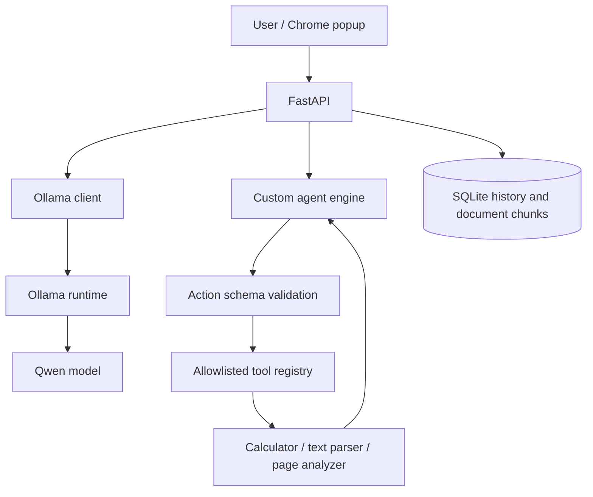

# Architecture

The LLM proposes text/actions; Python owns permissions, validation, tool execution, limits and state transitions. Current document retrieval is lexical SQLite search, not vector search.
